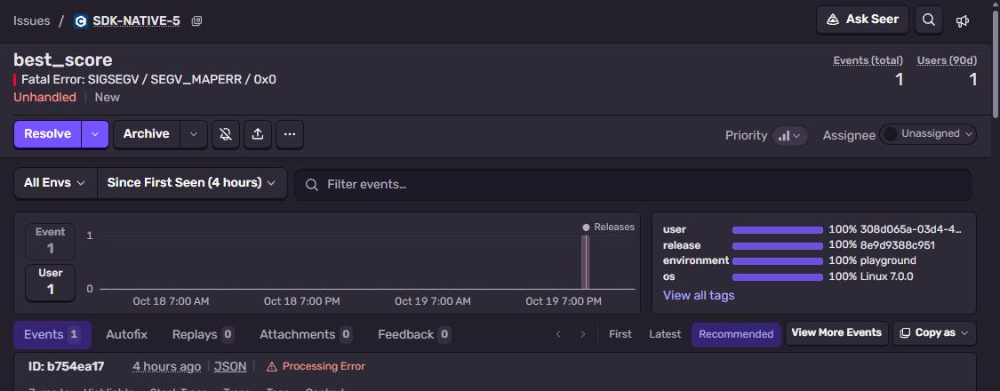
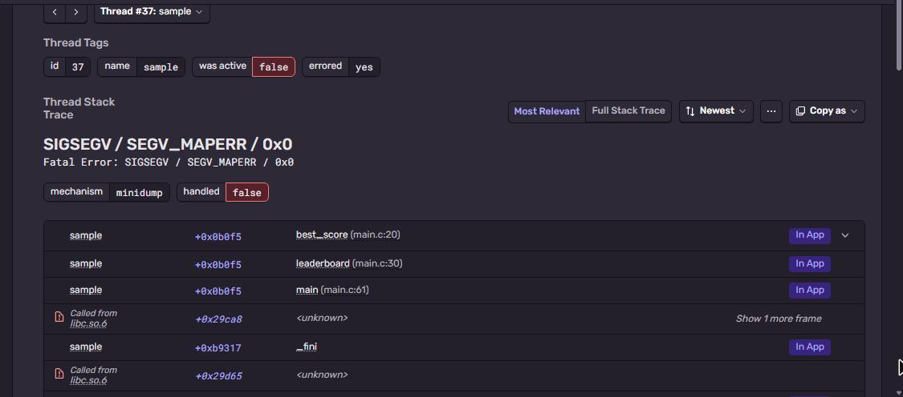

# Sentry + Native (C/C++) with crashpad

C program with `sentry-native` that really crashes (SIGSEGV). crashpad writes a minidump and uploads
it, Sentry symbolicates it with debug files uploaded from CI.
Part of [Sentry Playground](https://github.com/fsmaster/sentry-playground), this is the "Crash dump"
button there.



## What you need

- Linux or Docker (the Dockerfile builds everything, this is the easy way)
- For a local build: CMake 3.18+, a C/C++ compiler, `libcurl` dev package, `zlib`
- Sentry project with platform **Native**
- Sentry auth token for the symbol upload: **Settings → Auth Tokens → Create New Token** (org token is
  enough)

## 1. Build and run with Docker

```bash
git clone https://github.com/fsmaster/sentry-sample-native.git
cd sentry-sample-native
docker build -t sentry-sample-native .
docker run --rm -e SENTRY_DSN="https://<key>@<org>.ingest.us.sentry.io/<project-id>" \
  sentry-sample-native ./sample crash test-1
```

Output: `crashing, minidump goes to Sentry...`, exit code 139 (segfault).

`./sample error test-2` sends a normal event with stack trace instead of crash.

## 2. Upload debug symbols

The image has **stripped** binaries, like you ship to users. The debug info is in a separate Docker stage
`symbols`. Export it and upload:

```bash
docker build --target symbols -o type=local,dest=symbols .
export SENTRY_AUTH_TOKEN=sntrys_...
npx @sentry/cli debug-files upload --org <your-org> --project <your-project> symbols
```

```
> Found 3 debug information files (1 with embedded sources)
  UPLOADED 3035a406-... (sample; x86_64 library)
  UPLOADED 5b9e9f32-... (crashpad_handler; x86_64 library)
```

`sample.src.zip` is a source bundle (made in the build stage by `sentry-cli debug-files bundle-sources`)
with `main.c` inside. Honestly, in my tests Sentry accepted it but did not show the C code inline for
this minidump, so don't count on it. What works reliably is the GitHub integration with a code mapping
`/src/` → repo root: every frame gets a link to the exact line on GitHub.

Order doesn't matter. If the crash came first, Sentry re-processes it after symbols arrive (click
**Reprocess** if it doesn't).

## 3. Check it in Sentry

Issue title is the crashing function `best_score`, `Fatal Error: SIGSEGV / SEGV_MAPERR / 0x0` (read of
address 0, our `NULL`). Stack trace: `main` → `leaderboard` → `best_score` with `main.c` line numbers:



Frames of `sample` are marked **In App** because of a stack trace rule in the project
(**Settings → Projects → (project) → Stack Trace Rules**): `package:**/sample +app`. Without it native frames
are all grey. The red "Processing Error" is about `libc.so.6` and other system libraries, we didn't upload
their symbols. Harmless, our frames are fine.

If you want to keep the original `.dmp` file, turn on **Settings → Projects → (project) → Security & Privacy → Store Native Crash Reports**. Off by default.

## How it works

```c
sentry_options_t *options = sentry_options_new();
sentry_options_set_dsn(options, getenv("SENTRY_DSN"));
sentry_options_set_handler_path(options, "./crashpad_handler");
sentry_options_set_database_path(options, "/tmp/.sentry-native");
sentry_init(options);
```

- `crashpad_handler` is a separate process. When the app crashes, the handler (still alive) writes
  the minidump and uploads it. That's why it works even when the crashing process is totally broken.
- Database path must be writable, crashpad keeps there the reports which are not sent yet.
- A minidump has only addresses. Sentry matches it to the uploaded debug files by **build id**, so
  you must upload symbols from the *same* build that you ship. Rebuild = new build id = upload again.

CMake pulls sentry-native as subdirectory with `SENTRY_BACKEND=crashpad`:

```cmake
set(SENTRY_BACKEND crashpad CACHE STRING "" FORCE)
add_subdirectory(external/sentry-native)
target_link_libraries(sample PRIVATE sentry::sentry)
```

CI (`.github/workflows/image.yml`) builds the image, exports `symbols` from the same build cache and
uploads them, so image and symbols always match.

`/trigger` also takes an optional `"dsn"` in the body. The playground sends it when a visitor checks
**Use my DSN**, then only this one event goes to their project (a separate client, the global one is untouched).

## Troubleshooting

| Symptom | Why |
|---|---|
| Crash, but nothing in Sentry | `crashpad_handler` not found next to the binary, or database path not writable. Run with `SENTRY_DEBUG=1`. |
| Frames show `<unknown>` and addresses | Symbols for this build id not uploaded. Check **Settings → Debug Files** in the project. |
| All frames grey, nothing "In App" | Add the stack trace rule above with your binary name. |
